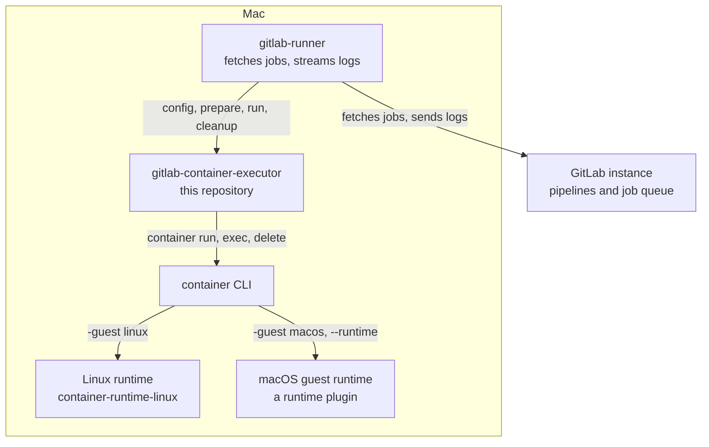

<!-- doc_type: explanation -->

# How a job reaches a container

Four programs take part in every job, from the GitLab instance down to the runtime that runs the
job. This page explains what each one does and where the executor of this repository fits in.

## The layers

| Layer | What it does | Where it comes from |
|---|---|---|
| GitLab instance | Holds the pipelines and queues their jobs | Any GitLab installation the runner can reach |
| `gitlab-runner` | Fetches a job, enforces cancel and timeout, and sends the job log back | GitLab Runner, built for the Mac |
| `gitlab-container-executor` | Starts one container per job, runs each stage in it, and removes it | This repository |
| `container` CLI | Creates, runs and deletes the containers | Apple `container` |
| Runtime | Runs the job's Linux container or macOS guest | `container-runtime-linux`, or a runtime plugin for macOS guests |

The runner never talks to `container` itself. It calls the executor once for each stage of the
[custom executor](https://docs.gitlab.com/runner/executors/custom/) protocol. The executor uses
only the `container` CLI as its interface to the runtime
([ADR 0001](adr/adr_0001_cli_is_the_runtime_interface.md)).

## Linux and macOS jobs

`-guest linux` jobs use the Linux runtime of a stock `container` installation. `-guest macos`
jobs use the runtime that `-runtime` names. That runtime must meet the
[runtime contract](adr/adr_0004_one_repository_for_ci_integrations.md#contract-with-a-macos-guest-runtime),
and it may need a `container` build other than a stock release.

Only one set of `container` services runs on a Mac at a time. When the macOS guest runtime needs
another `container` build, that build also runs the Linux jobs.

## Names and labels

The executor names each job container `<prefix>-<runner short token>-<job id>`. It lowercases the name and maps other characters to `-`. Each container carries the labels `owner`, `prefix`, `runner` and `job` in the `io.github.extra-code.container-ci.` namespace, and macOS guests also carry `contract`. The sweep finds orphans by the owner and prefix labels and the container's age.
