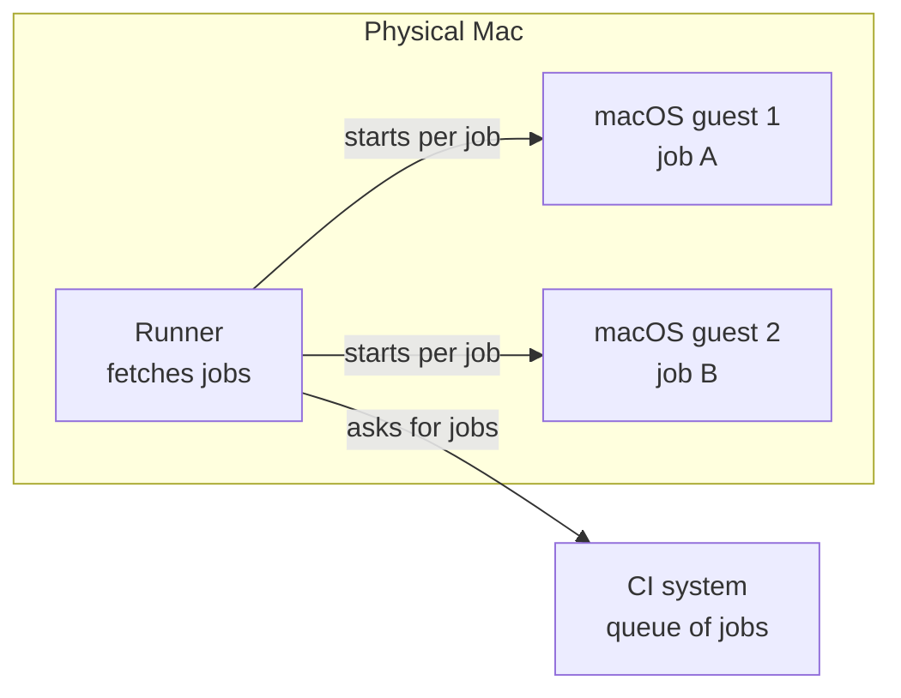
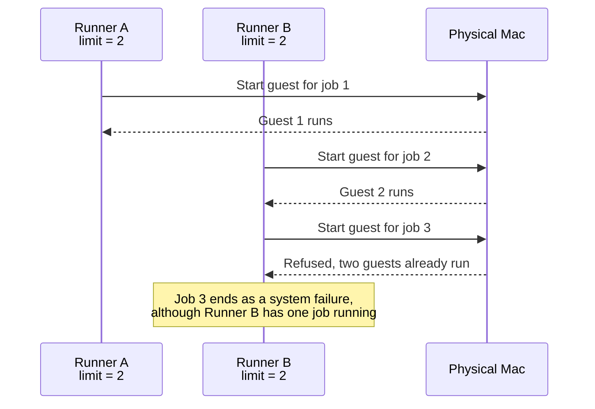

<!-- doc_type: explanation -->

# The macOS guest limit

At most two macOS guests run at the same time on one physical Mac. This page explains what that
limit means for CI runners and jobs.

The executor runs macOS jobs with `-guest macos`, see [macOS jobs](../README.md#macos-jobs). The [runtime contract](adr/adr_0004_one_repository_for_ci_integrations.md#contract-with-a-macos-guest-runtime)
describes what macOS jobs rely on.

## Mac, runner and guest

| Term | What it is | How many |
|---|---|---|
| Physical Mac | The hardware | 1 |
| Runner | A program on the physical Mac that fetches jobs from the CI system | Any number |
| macOS guest | A virtual Mac that exists for one job and is deleted afterwards | At most 2 running at a time |

A runner is neither the physical Mac nor a guest. It runs on the physical Mac and starts one guest
per job.

## What counts

| Counts toward the limit | Does not count |
|---|---|
| Every running macOS guest | The macOS of the physical Mac |
| A running macOS guest of another virtualization tool on the same Mac | Linux containers |
| | Stopped guests and guest images on disk |

Virtualization.framework enforces the limit and refuses a third guest. Linux containers are limited
only by the Mac's CPUs and memory.

## What happens to a third job

The Mac always refuses a third guest. The outcome for the job depends on whether a runner holds the
job back first.

| Setup | Third job |
|---|---|
| One runner with `limit = 2` | The runner does not fetch it. The job waits in the CI system until a guest ends. |
| No limit on the runner | The start fails, and the job ends as a system failure. |
| Several runners on one Mac | Each runner counts only its own jobs. Together they can start a third guest, and that job ends as a system failure. |

A failed start is retried only as far as the job's `retry:` setting allows.

The following sequence shows two runners that each stay within their own `limit = 2`:

## Which setup to use

Run one runner with `limit = 2` for macOS jobs on a Mac. Several runners on one Mac need a lock
shared across the host, which the executor does not have.
